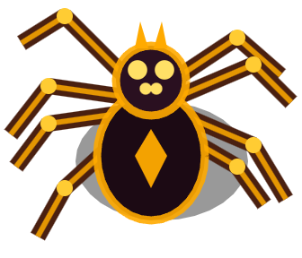
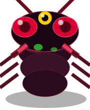

<div align="center"> 

# ALIEN EGG HUNTER

[](https://juandiegosuarezepn.itch.io/alien-egg-hunter)
[](https://phaser.io)
[](https://www.epn.edu.ec)
[](https://juandiegosuarezepn.itch.io/alien-egg-hunter)

<br/>


> *"Un planeta hostil. Especímenes desconocidos. Una misión de recuperación que puede convertirse en una operación de supervivencia."*

**[JUGAR EN ITCH.IO](https://juandiegosuarezepn.itch.io/alien-egg-hunter)** · **[LANDING PAGE](https://2026b-sof-jueg-gr1.github.io/SuarezBarberan-JuanDiego-jueg-gr3/)**

</div>

---

## Contrato Espacial — Cláusula 7-B

Eres un **mercenario interestelar** de élite. Te han contratado para infiltrarte en un planeta hostil, localizar los nidos de especímenes alienígenas y extraer los huevos antes de que la colonia entera se despierte.

¿El problema? **Las arañas ya saben que estás ahí.**

---

## Especímenes Catalogados

<div align="center">

|  |  |  |  |
|:---:|:---:|:---:|:---:|
| **ARÁCNIDO HOSTIL** | **HUEVO BIOLÓGICO** | **LARVA DE CRÁTER** | **MEDUSA RAZOR** |
| Patrulla el planeta y persigue cualquier intruso detectado | Muestra de alto valor. Requiere corte táctico para extraer | Emerge de los cráteres en frenzy. Territorial, se alimenta de baba y lucha a muerte | Amenaza crítica — *próximamente* |

</div>

---

## Mecánicas de Supervivencia

### Controles
| Acción | Teclado | Móvil |
|--------|---------|-------|
| Mover | `↑` `↓` `←` `→` | Joystick virtual |
| Disparar | `F` | Botón `F` |
| Extracción | `E` | Botón `E` |
| Pausa | `SPACE` | Botón `\|\|` |

### Minijuego de Corte Táctico
Acércate a un nido y desliza el mouse (o dedo) de izquierda a derecha para cortar la cápsula. El primer huevo que toques activa la alerta — **todas las arañas vendrán por ti**.

### La Furia de la Madre
Al recolectar **más de 3 huevos**, la Madre de las Arañas emerge furiosa desde el cielo. El ambiente se tiñe de rojo, spiders caen desde arriba y brotan de los cráteres del planeta en oleadas.

### Larvas de Cráter
Al matar la primera araña, las larvas **se ocultan en sus cráteres** y luego emergen en modo caza. Son territoriales: pelean entre sí por la baba del suelo, atacan a las arañas y al jugador. Las más fuertes sobreviven, crecen y entran en **frenzy**.

### Extracción Orbital
Presiona `E` para llamar a la nave corporativa. Dependiendo de cuántos huevos llevas:
- **Con huevos:** La corporación envía apoyo inmediato con láser defensivo
- **Sin nada:** *"¿En serio no te llevarás nada? Adiós."*

Llega a la zona de extracción `[ X ]` antes de que se agote el tiempo.

---

## El Mundo

El planeta mide **2000 × 1500 unidades** — mucho más grande que la pantalla. Usa el **RADAR PLANETARIO** (esquina inferior derecha) para localizar huevos, enemigos y la zona de extracción sin perderte.

---

## Stack Tecnológico

```
Phaser 3.60     →  Motor de juego y física Arcade
JavaScript ES6  →  Lógica, IA de enemigos, generación procedural
HTML5 + CSS3    →  Landing page y diseño responsivo
Canvas API      →  Renderizado de texturas procedurales
GitHub Pages    →  Hosting de la landing page
Itch.io         →  Distribución del juego
```

---

## Ejecutar en local

```bash
git clone https://github.com/2026B-sof-jueg-gr1/SuarezBarberan-JuanDiego-jueg-gr3
cd SuarezBarberan-JuanDiego-jueg-gr3
# Abre index.html con Live Server (VS Code) o cualquier servidor local
```

> Debe ejecutarse desde un servidor HTTP (no desde `file://`) porque Phaser carga assets con fetch.

---

<div align="center">

**ALIEN EGG HUNTER** // EXPEDICIÓN 7-B

Desarrollado por **Juan Diego Suárez** — Escuela Politécnica Nacional

</div>